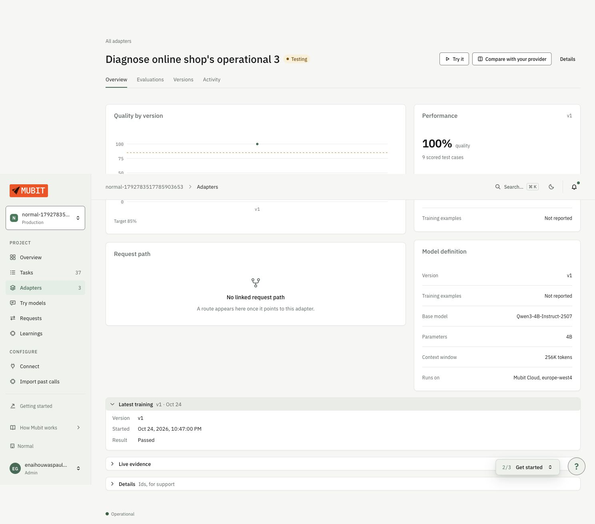
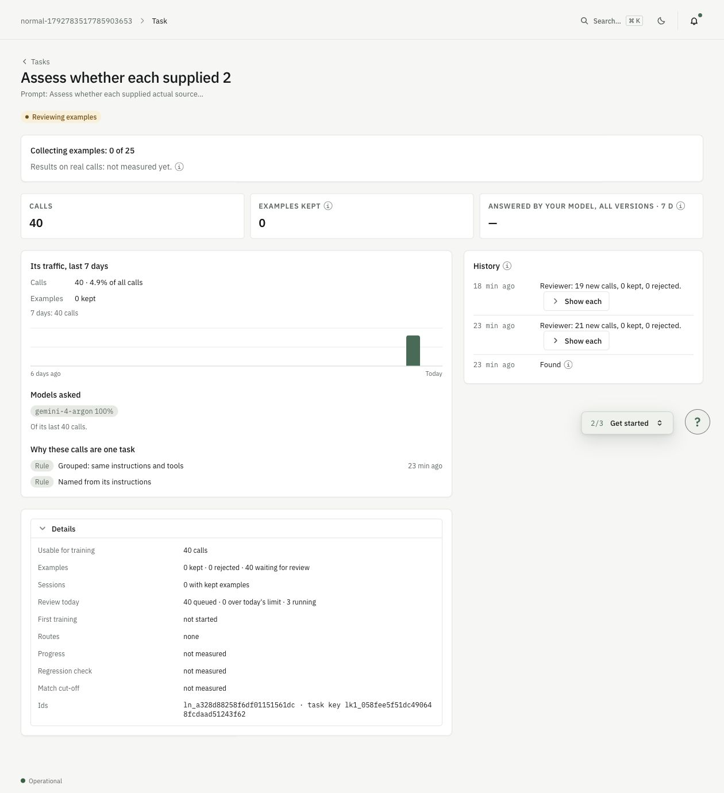

# ExplainWhy Agent

**Open Agent Hackathon 2026** — Track 02 (*The Agent That Can Explain Why*) · evidence-backed investigation across fragmented business data.

**Run it locally in two commands:** [Quick start](docs/QUICKSTART.md):
`./scripts/local/setup.sh` once, then `./scripts/local/start.sh`. It uses a local
Nemotron model through Ollama and needs no cloud keys.

**Full sponsor setup:** use branch `codex/sponsor-integrations` and the
[step-by-step Mac runbook](docs/friend-mac-runbook.md). The current runtime uses
Postgres, NVIDIA Nemotron (local or hosted), optional Bright Data research, Zetaris
and Meterless H-MEM, with the bundled Animation Studio renderer. Older Mubit demo
recordings and model receipts below are historical evidence, not current setup
requirements. Live four-sponsor acceptance must be completed with the operator's
credentials and Mac runtime.

**Sponsor integration status:** Meterless H-MEM now provides sourced historical recall and separate prompt context. A scoped Zetaris SQL evidence connector and local Docker setup are implemented; a live Zetaris query is still blocked on image entitlement and instance configuration. The existing video predates these changes. [Setup, verification and demo steps](docs/sponsor-integrations/README.md).

**Connected financial animation:** ExplainWhy can send verified baseline/current measurements to the bundled Animation Studio and display the resulting MP4 and editable Blender project. Local Nemotron and Bright Data research are configurable alongside the existing Zetaris/H-MEM integrations. [Mac setup, failure handling and verification limits](docs/connected-animation.md). A synthetic chart was rendered and the browser flow verified here; a complete live sponsor run on the host Mac remains to be recorded.

**Find the business problem. Check the evidence. Approve the next step. See what happened.**

A small ecommerce business can see that sales have fallen. Finding the reason usually means moving between advertising reports, orders, delivery updates and customer feedback, then deciding what to do with incomplete information.

We built ExplainWhy Agent to bring that work into one place. It watches business activity, groups unusual changes into an investigation, uses NVIDIA Nemotron to compare possible explanations, and proposes a response that a person can review. Approved actions run through restricted tools. ExplainWhy saves the changes and assesses later observations against the plan's success criteria.

Our hackathon demonstration uses an **Nike shop simulation**. The orders, customers, advertising activity and deliveries are synthetic. The model requests, database records, validation checks and recorded changes described below are genuine development/demo results. Nothing here changes a real advertising account, sends a real customer email or takes a real payment.

## Start here

<!-- current-demo:start -->
**Watch the current product demo:** [ExplainWhy Agent — continuous product and Mubit console recording](docs/demo/ExplainWhy_Demo.mp4) · **1:50 · 4.98 MB**. The recording shows the dashboard, evidence, plan review, approved simulated actions, verified receipts and the signed-in Mubit console. Natural synthesized narration with no added overlays or music. [Demo details and limits](docs/demo/README.md) · [Media verification](docs/demo/verification.json).
<!-- current-demo:end -->

If you have two minutes, follow this evidence trail:

1. **The investigation:** [saved Mubit report](docs/stage5-runs/stage5_1792885194280.json) — five model calls, six verified internal evidence records and no unresolved citations.
2. **The proposed response:** [saved planner output and handoff](docs/stage6-runs/advertising-plan.json) — compare alternatives and inspect the exact campaign, amount, evidence and approval requirement.
3. **The result after approval:** [execution audit](docs/stage7-runs/audit.json) — the budget is read back from the database at 6750 GBP minor units, with an action receipt and callback event.
4. **The browser proof:** [recorded browser results](docs/stage7-runs/browser.json) and [budget-after screenshot](docs/stage7-runs/meta-after.png) — the refreshed campaign table shows £67.50/day.
5. **The later outcome:** [saved assessment](docs/stage8-runs/controlled-observation.json) and [Outcomes screenshot](docs/stage8-runs/outcomes-controlled.png) — a separate isolated simulator run has complete before/after windows, but no observed return improvement and one unmet criterion.

The first four items are connected records. The execution demonstration is an isolated copy of the saved investigation and plan; its [copy manifest](docs/stage7-runs/acceptance.json) names the original run, original plan and source hash. The fifth item follows another isolated copy, with its own approval, execution and later observations. Neither copy claims a new model call.

The updated demo also covers a [shipping response](#another-use-case-delayed-shipping): approved delay notices followed by a factual storefront banner. Its diagnosis is a labelled fixture, so it demonstrates the review and execution path rather than a new live Mubit investigation.

**New proof moments (27 Oct):** a checkout incident with a **planted false lead**. One campaign's ads collapse at the same moment the promo code breaks, so the detector headlines it as an advertising incident. A second check comes from a **blind NVIDIA Nemotron verifier** that audits every diagnosis against the same verified evidence and flags disagreement for review. A new **direct NVIDIA route** (`EXPLAINWHY_MODEL_PROVIDER=nvidia`) runs the whole investigation on Nemotron 3 Super without Mubit and needs only `NVIDIA_API_KEY`. All three are implemented and tested, and the deterministic evidence is recorded. Live model runs are pending the key. [What is planted, what the evidence shows, and limits](docs/proof-moments/README.md).

**Evidence snapshot:** the Stage 5–7 artifacts were reviewed against `2436c4b`; the Stage 8 assessment and interface checks are documented in their linked reports from 25 October 2026. Results below belong to those recorded checks. A fresh full regression of this combined version is not established.

## What the demo shows

The main story follows a deteriorating advertising campaign:

| Step | What happens | Where to inspect it |
| --- | --- | --- |
| Detect | Recorded activity produces an advertising incident. ExplainWhy compares the affected period with its baseline. | [Investigation artifact](docs/stage5-runs/stage5_1792885194280.json), [detector](src/intelligence/detection/engine.ts) |
| Investigate | The Mubit investigator checks competing explanations and calls read-only evidence tools. The saved report includes citations and uncertainty. | [Investigator controller](src/intelligence/investigator/controller.ts), [report audit](docs/stage5-runs/report-audit-final.json) |
| Plan | Mubit compares a targeted budget reduction, a broader reduction and further investigation without changes. Deterministic checks reject unsupported proposals. | [Planner artifact](docs/stage6-runs/advertising-plan.json), [planner validation](src/planner/validation.ts) |
| Review | A person approves an exact plan version and selected actions. Approval and execution are separate steps. | [Approval/execution screenshot](docs/stage7-runs/approval-execution.png), [approval route](src/app/api/plans/[id]/approve/route.ts) |
| Execute and check | The approved marketing action changes the simulated campaign budget from **£90 to £67.50/day**. ExplainWhy reads the result back and records the receipt and event. | [Audit](docs/stage7-runs/audit.json), [browser record](docs/stage7-runs/browser.json), [execution implementation](src/execution/) |
| Assess | ExplainWhy compares later campaign observations with the approved plan's criteria and keeps the original receipt separate from the business assessment. | [Stage 8 report](docs/stage8-verification.md), [assessment implementation](src/outcomes/), [Outcomes screenshot](docs/stage8-runs/outcomes-controlled.png) |

The campaign is `cmp_basketball_search`. Its proposed 25% reduction is tied to campaign-specific evidence, including zero attributed orders in the observed window. It is a cautious intervention, not a prediction that revenue will recover.

The advertising run's injected scenario was `ad_fatigue`; the investigator selected a qualified `ad_inefficiency` explanation and retained alternatives. We do not count this as an exact root-cause match or a definitive causal finding. The distinction is visible in the saved report's metrics and hypotheses.

The original Stage 7 advertising run has **0/30 post-action hours**, so its business assessment remains pending. A separate Stage 8 copy of the same saved plan received its own approval, executed the budget change and advanced 30 virtual hours. Its complete windows show spend **£122.31 → £91.92**, CTR **0.60% → 0.49%**, zero attributed orders in both windows and no observed return improvement. The spend and order criteria were met; the CTR criterion was not. This comparison does not establish what caused the CTR change. [Controlled observation](docs/stage8-runs/controlled-observation.json) · [Stage 8 method and limits](docs/stage8-verification.md).

### Another use case: delayed shipping

The shipping demonstration starts from a **labelled test fixture** for a delivery-delay diagnosis. Its reviewed plan orders two actions: send delay notices to the two eligible simulated customers, then publish a factual delivery banner. A person approves the exact plan and action set before execution. The [audit](docs/stage7-runs/audit.json) records both messages in the demo inbox, the banner on the simulated store, adapter receipts and callback events. See the [shipping fixture](docs/stage7-runs/shipping-fixture.json) and [visible banner](docs/stage7-runs/nike-banner.png).

This demonstrates approval, ordered execution and read-back for customer care. The shipping diagnosis was supplied as a fixture; this run did not make a fresh Mubit diagnosis call or send a real customer message. Its [later assessment](docs/stage8-runs/demonstration.json) is pending because there is no linked comparison cohort to measure a shipping or support benefit.


ExplainWhy is configured to use the **NVIDIA API catalog** (default **Nemotron 3 Super**) for investigation, source-support checks, diagnosis and solution planning via the [provider](src/intelligence/investigator/provider.ts). Optional **grounded public research** uses **direct Gemini** when `EXPLAINWHY_EXTERNAL_RESEARCH_ENABLED=true` and `GEMINI_API_KEY` is set. Server credentials live in [.env.example](.env.example); never expose keys through `NEXT_PUBLIC_` variables.

**Task profiles** replace hosted adapter training: approved examples are promoted only after a frozen held-out comparison passes the pilot gate. See [training integration](docs/training-integration.md). Archived Mubit/Gemini pilot artifacts remain under `docs/training/` for historical reference only.

Historical request and evaluation artifacts retain the model IDs that actually produced them. They document earlier runs and do not establish Gemini 4 Argon accuracy or adapter improvement.

| Recorded task | Evidence of actual requests | Result and boundary |
| --- | --- | --- |
| Advertising investigation | Five request IDs in [the saved run](docs/stage5-runs/stage5_1792885194280.json), beginning `mreq_01a1704a2da17a43bcdbc66d3a46f3d2`; **30,477 reported tokens** | Completed, qualified diagnosis; six verified evidence records, four cited records, zero unresolved citations. |
| Checkout investigation | Three request IDs in [the saved checkout run](docs/stage5-runs/s5eval_1792881375759_0_0.json); **11,735 reported tokens** | Completed `discount_failure` diagnosis on held-out seed 11; two evidence records, four citations, zero invalid citations. One scenario result, not a general accuracy score. |
| Advertising strategy generation | `mreq_01a170a09c2c775184fffe17575bd54c`, with earlier attempts preserved in [the planning record](docs/stage6-runs/advertising-plan.json) | A valid targeted proposal was selected. The broader reduction was blocked when its individual targets lacked sufficient support. |
| Checkout strategy generation | Request `mreq_01a170a089347992a28b32b637d4f5a2` in the [checkout planning archive](docs/stage6-runs/checkout-advisory.json) | Mubit compared three advisory strategies for a coupon failure. There is no coupon-repair adapter, so this saved archive has no executable plan or approval handoff. |
| External-source check | Discovery and passage-assessment IDs in [the source acceptance record](docs/stage5-runs/source_acceptance_1792885169199.json) | A narrow Nike employee-note claim was supported; an unsupported Google Ads outage claim was not. This was a separate source check, not causal evidence for the advertising incident. |

ExplainWhy Agent keeps a durable call ledger with provider request IDs, route, model, reported token use, output or error, prompt version, stable task fingerprint and per-input checksum. Provider errors and ambiguous billable requests are recorded rather than silently replayed. See [provider tests](tests/investigator/provider.test.ts).

To exercise these paths locally, configure `NVIDIA_API_KEY`, run `npm run investigator:check`, then start `npm run investigator:work` and `npm run planner:work`. Research is opt-in and requires `GEMINI_API_KEY`. The saved [Stage 5](docs/stage5-verification.md) and [Stage 6](docs/stage6-verification.md) reports document earlier recorded runs.

### Task profiles and archived adapter pilots

In-house **task profiles** are the supported learning loop. The hosted-console pilots below are archived evidence only:

| Task | Recorded result | What it means |
| --- | --- | --- |
| Existing diagnostic adapter, `ad_lane_0026fbd6`, v1 | Mubit displays **Passed**, with 100% teacher agreement on **nine** test cases. No production request path is linked. | Mubit produced and tested an adapter. This is its own small teacher-agreement check, not proof of better diagnosis. |
| Diagnostic comparison on six new synthetic cases | The available reference matched **6/6** authored primary conclusions; the adapter matched **5/6**. It mistook a tracking problem for checkout failure. | We found a concrete error and did not promote the adapter. The reference was `gemini-3.8-flash`; the original teacher, `gemini-4-argon`, was unavailable. These agent-reviewed counts are not independently adjudicated accuracy. |
| Historical source-support pilot, `gpt-6-luna` | **40/40** collection calls completed. The console at **07:22 UTC, 25 October 2026** showed **0 kept, 0 rejected, 40 awaiting review; first training not started**. A separate provider baseline matched **15/24** authored labels. | Collection works; this task has no trained version to compare yet. The 24 held-out cases were excluded from training storage. |
| Current Gemini 4 Argon source-support pilots | **40/40** teacher calls per route, plus **18/24 (75%)** held-out rubric agreement on each route. At the latest saved check, both tasks show **0 kept, 40 awaiting review; first training not started**. | The baseline is complete. Adapter improvement remains unmeasured; held-out calls were metadata-only. [Full Gemini evaluation](docs/training/gemini-source-support-evaluation-2026-10-25.md). |



*Existing diagnostic adapter: the latest training result says Passed. The same console shows no linked production request path. The displayed 100% belongs to Mubit’s nine-case check.*



*Current Gemini 4 Argon task: 40 usable calls, 40 waiting for review, 3 running, and first training not started. The linked status file records the observation timestamp. The workspace’s three existing adapters belong to other tasks.*


*The comparison preserves an error rather than claiming improvement: normal payments and orders contradict the adapter’s checkout-failure conclusion.*

The [evaluation report](docs/adapter-evaluation-2026-10-25.md) links the frozen cases, actual replies and scored rows. The [training runbook](docs/training-integration.md) links all 64 source-support calls and explains safe resumption and the pending comparison. Run `npm run training:source -- report` to recompute that pilot locally without an API key or new provider calls. **No independent quality improvement, production speedup or cost saving is established.** Local corrections and outcome feedback do not automatically retrain Mubit.

## Evidence you can check

The linked JSON files contain the underlying records; the verification reports explain how they were obtained and what they do not establish.

| Claim | Evidence | What it proves |
| --- | --- | --- |
| The saved advertising report is internally consistent. | [Report audit](docs/stage5-runs/report-audit-final.json) | **13/13 checks passed**, including diagnosis, brief, citations, impact reference, request attribution and a non-executable investigation handoff. This is consistency, not causal truth. |
| Planning does not itself change the business. | [Stage 6 preservation result](docs/stage6-runs/preservation-after.json), [planner tests](tests/planner/validation.test.ts) | Planning created proposals without receipts, notices, banners or budget changes. |
| An approved budget change was persisted and verified. | [Execution audit](docs/stage7-runs/audit.json), [browser results](docs/stage7-runs/browser.json), [before](docs/stage7-runs/meta-before.png) / [after](docs/stage7-runs/meta-after.png) | £90 → £67.50/day, one durable receipt and a verified budget callback; the browser checked the result after refresh. |
| Unsafe or repeated execution is rejected. | [Execution integration tests](tests/execution/integration.test.ts), [Stage 7 report](docs/stage7-verification.md) | Checks cover missing approval, wrong scope/version, changed targets, expired approval, altered parameters, dependencies and duplicate requests. |
| Shipping actions respect their order. | [Shipping fixture](docs/stage7-runs/shipping-fixture.json), [execution audit](docs/stage7-runs/audit.json) | Two demo notices followed by a factual banner, with saved receipts and callbacks. |
| Later results are kept separate from execution success. | [Stage 8 assessment record](docs/stage8-runs/demonstration.json), [controlled observation](docs/stage8-runs/controlled-observation.json) | The original run remains pending; a separate 30-hour run has a completed comparison with no observed return improvement. Neither is a causal effect estimate. |
| The storefront reads persisted product data. | [Browser results](docs/stage7-runs/browser.json), [storefront screenshot](docs/stage7-runs/nike-storefront.png), [browser test](tests/e2e/stage7-partner.spec.ts) | 17 products, 141 local images, decoded catalogue images, filtering, a second detail image and one persisted simulated checkout order. |
| Public-source cards distinguish support from speculation. | [Source records](docs/stage5-runs/source_acceptance_1792885169199.json), [integration browser record](docs/stage5-runs/source-card-integration-browser.json) | Genuine source discovery/retrieval and positive/negative claim checks; the final source-card integration used an explicitly file-backed report fixture. Spontaneous research within a relevant live investigation remains unverified. |
| Existing demonstration data was preserved. | [Stage 7 before](docs/stage7-runs/preservation-before.json) / [after](docs/stage7-runs/preservation-after.json), [verification report](docs/stage7-verification.md) | Hashes match across 39 original collections outside the new isolated acceptance scopes; active selection remained `demo_nike`. |

### Detector evaluation

The [committed detector evaluation](docs/evaluation/detection-evaluation.json) records 15 seeded runs for each scenario, with separate development and held-out groups. This evaluates detection on synthetic activity; it does not measure Mubit diagnosis accuracy or prove performance on a real shop.

| Synthetic scenario | Detected | Opened an investigation-worthy incident |
| --- | ---: | ---: |
| Advertising fatigue | 15/15 | 15/15 |
| Delivery delays | 15/15 | 15/15 |
| Viral demand | 15/15 | 15/15 |
| Promotional checkout failure | 15/15 | 1/15 |
| Negative reviews | 5/15 | 4/15 |

Across the 15 healthy runs, one incident was recorded. Checkout escalation and sparse negative-review detection remain clear weaknesses in this evaluation. The exact seeds, scenario durations and results are included so those limits are inspectable.

### Recorded software checks

| Scope | Recorded result | Source |
| --- | --- | --- |
| Stage 5 source/evidence/card checks | **64/64 focused tests**, plus **1/1** desktop source-card integration test | [Stage 5 verification](docs/stage5-verification.md) |
| Stage 6 planner | **21/21 focused tests**, plus **1/1** desktop planning acceptance | [Stage 6 verification](docs/stage6-verification.md) |
| Stage 7 approval/execution and partner interfaces | **31 focused tests**, plus **1/1** desktop production-build acceptance; no browser page errors | [Stage 7 verification](docs/stage7-verification.md) |
| Contracts | Typechecking and **15/15** examples passed in the Stage 7 verification | [Shared contracts](packages/contracts/README.md), [Stage 7 verification](docs/stage7-verification.md) |
| Stage 7 build/static checks | Production build and TypeScript passed; ESLint had **0 errors and 14 warnings** | [Stage 7 verification](docs/stage7-verification.md) |
| Stage 8 outcome assessment | **27/27 focused tests** and **1/1** desktop acceptance; build and TypeScript passed | [Stage 8 verification](docs/stage8-verification.md) |
| Investigation decision canvas | **4/4** focused desktop checks; TypeScript and build passed | [Canvas verification](docs/investigation-redesign-verification.md) |
| Adapter-training integration | **83/83 focused tests**, TypeScript, production build, focused lint and **15/15** contract examples passed; saved pilot recomputed offline | [Training validation and reproduction](docs/training-integration.md#validation) |
| Full regression | Recorded checks passed **385/385 tests across 62 files** and **66/66 browser tests across desktop and mobile**. Contracts (15/15), TypeScript, ESLint (0 errors, 14 warnings) and the isolated production build passed. | [Stage 8 verification](docs/stage8-verification.md), [historical results](docs/stage5-verification.md#focused-verification-policy-and-latest-results) |

The focused test counts overlap in places and should not be added together. The original stage-specific reports predate the complete desktop/mobile regression. The canvas report also records a failed global unchanged-data guard while other workers changed monitoring state; it does not claim global preservation.

## Architecture

```mermaid
flowchart LR
    A[Business activity] --> B[Validated event ledger]
    B --> C[Metrics and detection]
    C --> D[Investigation and read-only evidence]
    D --> E[Nemotron investigator]
    E --> F[Validated diagnosis with citations]
    F --> G[Nemotron solution planner]
    G --> H[Validated proposed plan]
    H --> I[Human approval of exact version]
    I --> J[Restricted execution agents]
    J --> K[Simulated ads, inbox and storefront]
    K --> L[Read-back verification and callback events]
    L --> B
    B --> M
    L --> M[Later observation and outcome assessment]
    M --> N[Human feedback and saved history]
```



### Technologies and where they are used

| Technology | Role in this repository |
| --- | --- |
| **Next.js 16, React 19 and TypeScript** | The [App Router](src/app/) provides the dashboards, simulated storefronts and HTTP API routes. React renders the operator and partner views; TypeScript is used across the app, workers and shared contracts. Versions and scripts are in [package.json](package.json). |
| **Node.js and npm** | Run the web app, the independent monitoring/investigation/planning workers and the repeatable demo scripts. `tsx` runs the TypeScript worker and audit entry points. |
| **Supabase** | [Supabase Postgres](src/lib/mongodb.ts) is the system of record, reached through a [document store](src/lib/docstore/client.ts): one jsonb table per collection in a per-environment schema. Scoped collections persist the immutable business-event ledger, metric snapshots, monitoring jobs, evidence, model call records, diagnoses, plan versions, approvals, adapter receipts, execution history and outcome assessments. [Unique indexes](src/lib/collections.ts) become Postgres unique indexes for idempotency; [transactions](src/intelligence/detection/persistence.ts) are Postgres transactions; an insert log replaces Change Streams to wake the [monitoring worker](src/intelligence/monitoring/watcher.ts). See the [collection guide](docs/mongodb.md). |
| **NVIDIA Nemotron** | The [provider](src/intelligence/investigator/provider.ts) runs investigation, structured diagnosis, source-support assessment and planning through local Ollama/LM Studio or the hosted NVIDIA API. Call records include the actual model, route, request ID and validation status. |
| **Bright Data / optional Gemini research** | [Public-source research](src/intelligence/investigator/research.ts) uses Bright Data SERP discovery or direct Gemini grounded search. The four-sponsor Mac setup selects Bright Data. Candidates undergo independent retrieval, timing and claim-support checks. Older Mubit research receipts are archives. |
| **NVIDIA Nemotron (API catalog)** | The optional [independent verifier](src/integrations/nemotron/verifier.ts) runs after deterministic validation. `nvidia/llama-3.1-nemotron-70b-instruct` judges each competing cause against the verified evidence, and `nvidia/nemotron-4-340b-reward` scores each explanation. Results and per-call receipts are stored in the report; the verifier cannot edit the diagnosis. Enable it with `EXPLAINWHY_NEMOTRON_VERIFIER=true` and `NVIDIA_API_KEY`. See [proof moments](docs/proof-moments/README.md). |
| **Zod and `@explainwhy/contracts`** | [Shared schemas](packages/contracts/README.md) validate events, evidence, diagnoses, plans and execution records at API, model-output and persistence boundaries. |
| **TypeScript simulator and restricted adapters** | The [seeded digital twin](src/simulator/) generates synthetic shop, advertising, shipping and customer events. [Adapters](src/adapters/) apply only approved budget, delay-notice and banner actions to that twin; the Meta-style account, Nike-style shop and Shopify introduction are demo interfaces rather than live external accounts. |
| **CSS, Tailwind utilities and Lucide** | [Custom CSS](src/app/globals.css) styles the dashboard and partner views; Tailwind utilities support selected components, and [Lucide icons](src/components/explainwhy/InvestigationCanvas.tsx) label controls and states. |
| **Vitest, Playwright and ESLint** | [Vitest](vitest.config.mts) checks contracts, business rules and service integration; [Playwright](playwright.config.ts) checks browser flows; ESLint and TypeScript provide static checks. Recorded results and limits appear above. |

The detector and evidence tools use allowed observations rather than hidden scenario labels; the [data-boundary test](tests/intelligence/leakage.test.ts) checks those module boundaries. The planner can read scoped current target state to validate a proposed action. Saved outcome history and human feedback do not automatically retrain Mubit or change the planner. The [API guide](docs/api.md) and [partner integration guide](docs/partner-integration.md) describe the interfaces; older roadmap sections are historical, while the Stage 5–8 reports record the later implementation.

<details>
<summary>Original product architecture illustration</summary>

This illustration describes the broader product direction. The implemented flow and remaining limits are stated above and below.


</details>

## Run ExplainWhy Agent locally

Use Node.js 24, npm, local Postgres or Supabase Postgres, and either local Nemotron or a hosted NVIDIA API key. For all four sponsors and animation, follow the [Mac runbook](docs/friend-mac-runbook.md). The app creates its schema, tables and indexes on first use. The saved JSON reports can be reviewed without a database or provider account.

```sh
npm ci
cp .env.example .env.local
```

Set `DATABASE_URL`, `DATABASE_SCHEMA` and the local or hosted NVIDIA settings in `.env.local`. Configure only real Supabase Auth credentials if using Auth; otherwise leave its optional settings unset. To bring over data from an older MongoDB install, run `MONGODB_URI=… npm run db:migrate-mongo`. Keep credentials out of Git. Start the app:

```sh
npm run dev -- --port 3000
```

In separate terminals, from the same repository, start the workers for the paths you want to exercise:

```sh
npm run monitor:watch
npm run investigator:work
npm run planner:work
```

Open `/dev/simulator` to create a fresh named simulation run, advance its clock and inject a scenario. Use its run ID consistently in dashboard links. `/dev/monitor` shows monitoring progress. Investigations and planning require their workers; queued work will not complete from the web page alone.

The main routes are `/dashboard`, `/dashboard/signals`, `/dashboard/investigations`, `/dashboard/approvals`, `/dashboard/activity` and `/dashboard/outcomes`. The investigation page connects signals, evidence, decisions and outcomes; its details open in side panels. [Canvas example](docs/investigation-redesign/advertising-desktop.png). `/ads` shows the simulated campaign account; `/demo-store` and `/store` show the simulated shop. `/shopify` is a separately labelled synthetic introduction with no live Shopify connection.

### Reproduce or inspect the evidence

For a fresh isolated advertising investigation, the existing script creates a new run without changing active selection, requests Nemotron output and writes a report:

```sh
npm run demo:stage5
```

This makes paid/provider-credit model requests and writes a fresh isolated demo scope. Its output includes the run ID and investigation workspace URL. Completion depends on provider availability; a failed provider call must remain a failed/provisional result.

If the recorded acceptance runs are present in your configured database, the following rechecks their saved state without approving, executing or making a model request:

```sh
node --conditions=react-server --import tsx scripts/audit-stage7.ts
node --conditions=react-server --import tsx scripts/stage7-preservation.ts
node --conditions=react-server --import tsx scripts/demo-stage8.ts
```

These scripts refresh local audit reports and Stage 8 assessment records. They do not recreate records from JSON on an empty database; the Stage 8 script evaluates only the saved Stage 7 executions and makes no new model request or business action. To prepare a fresh execution demonstration, see [the Stage 7 procedure](docs/stage7-verification.md); its advertising copy preserves the source plan's expiry and deliberately fails after that plan expires. Use a new eligible plan rather than extending an old approval.

For checks, run:

```sh
npm run contracts:typecheck
npm run contracts:validate
npm run typecheck
npm run lint
npm test -- tests/investigator/provider.test.ts tests/investigator/validation.test.ts tests/planner/validation.test.ts
```

`npm run verify` also runs the full database-backed suite. Use a dedicated test database and allow for the long simulator evaluations. Browser tests use `npm run test:e2e`; live-model and Stage 7 acceptance cases have their own setup and existing-record requirements, documented in the verification reports. They are not a one-command fresh-database replay.

## What is real, simulated, and still unfinished

- **Implemented:** persisted monitoring and evidence, Mubit investigation and planning, exact-version human review, restricted execution, receipts, read-back verification and on-demand observational outcome assessment with separate human feedback.
- **Simulated:** customer activity, ad accounts, campaign effects, orders, delivery activity, inbox messages, purchases and storefront operations. The Shopify introduction is a separate presentation fixture.
- **Public reference material:** cited product information and contextual company sources. These describe the real brand; they do not establish the cause of a simulated business incident. See [data provenance](docs/data-provenance.md). Stage 7's local product-image implementation is documented in [its verification report](docs/stage7-verification.md).
- **Still unfinished:** production identity/roles, an always-on execution recovery worker, causal business-impact evaluation, automatic outcome-driven planning or model training, and a verified correction-to-adapter improvement loop. Provider cost remains unknown because rates are not configured. External research is optional and its combined spontaneous live-investigation acceptance remains unverified.

Action read-back confirms that a budget, message or banner changed as approved. Later assessments compare observed data only when coverage is sufficient; they do not prove that an action caused a business change. Interrupted or ambiguous actions require review; they are not automatically retried. Unsupported actions remain disabled or advisory.

The intended next step is to collect more comparable outcomes and test whether verified corrections improve task-specific models. The saved assessments alone do not establish that improvement.

## Further evidence and project context

- [Stage 4 implementation and historical verification](docs/implementation-report.md)
- [Stage 5 investigation verification and limitations](docs/stage5-verification.md)
- [Stage 6 planning verification](docs/stage6-verification.md)
- [Stage 7 approval/execution verification](docs/stage7-verification.md)
- [Stage 8 outcome verification](docs/stage8-verification.md) and [investigation canvas verification](docs/investigation-redesign-verification.md)
- [Data dictionary](docs/data-dictionary.md) and [simulation state](docs/simulator-state.md)
- [Official Mubit documentation](https://docs.mubit.ai/) and [Open Agent Hackathon 2026](https://hackathon.genai.works/dashboard)
