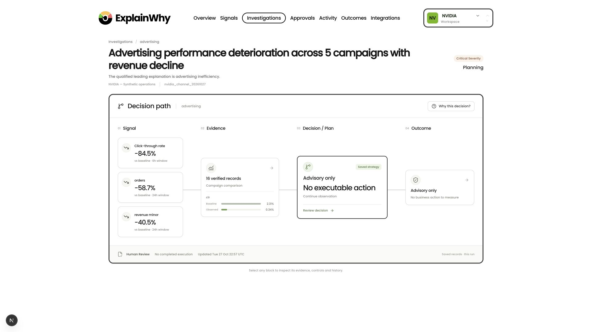

# ExplainWhy

**Find out why sales dropped, review the evidence, and approve what happens next.**



*A real product screen from our synthetic NVIDIA retail demo: the signal, supporting records, proposed response, and review status stay together.*

[Watch Demo](public/assets/ExplainWhy_UI_Walkthrough.mp4) · [Quick Start](docs/QUICKSTART.md) · [Architecture](docs/architecture.md) · [Evaluation](docs/evaluation/README.md) · [Evidence](docs/evidence.md)

## The problem

You run an online store. Sales are down, the ad account looks worse, and customers are reporting delivery problems. Before you change anything, you need to work out which signals belong together and which explanation the records actually support.

That usually means opening several dashboards, comparing different time windows, and asking someone to pull another report. A revenue chart shows the drop. It still leaves you with the investigation.

ExplainWhy brings that work into one place, so an operations team can check the explanation before committing to a response.

## From a sales drop to a decision

1. **Notice the change.** Monitoring compares business activity with its baseline and groups related signals into an investigation.
2. **Check the alternatives.** Nemotron examines advertising, checkout, inventory, and shipping evidence. Each finding links back to the records behind it.
3. **Bring in what you already learned.** Meterless H-MEM retrieves relevant findings from earlier investigations. They provide context for the new case.
4. **Review the next step.** Compare validated strategies, including further investigation or continued observation. Supported business changes need approval before execution.
5. **See what happened.** Approved changes get a receipt and a read-back check. Later observations can be compared with the plan when enough data is available.

Sometimes the right answer is to keep investigating. The NVIDIA example above recommends continued observation; it does not propose an unsupported budget change.

## Keep the dashboard useful after the investigation

**Analysis follows the data.** In local mode, a background worker notices database changes and refreshes the dashboard's Nemotron summary. You can inspect the source snapshot and model receipt behind each result.

**Turn a chart into a presentation.** Choose **Animate** on a supported chart, or **Animate dashboard** for the overview. Preview the same values, then export a silent Full HD or 4K MP4, an SVG slide, and the source snapshot.

[Automatic analysis](docs/automatic-local-analysis.md) · [Chart animations](docs/dashboard-presentations.md)

## What powers it

| Technology | Its job | Where it runs | Status |
| --- | --- | --- | --- |
| **NVIDIA Nemotron** | Compare evidence, produce a qualified diagnosis, rank validated local planning options, and summarise dashboard changes. | Locally through Ollama, or NVIDIA's hosted API | Verified locally: [recorded diagnosis and planning snapshot](docs/demo/nvidia-local-proof.json) |
| **Zetaris** | Query advertising observations and the campaign catalogue through SQL, then check returned measurements against source events. | Local Zetaris in Docker | Live query returned data in the [latest check](docs/sponsor-integrations/latest-check.json); row-by-row reconciliation with canonical events not yet verified |
| **Meterless H-MEM** | Store published investigation findings and retrieve relevant prior context, with source references and a recall ledger. | In-process (vendored engine) | Engine recall verified on a labelled fixture; in-app recall needs an earlier published report |
| **Bright Data** | Bounded public web research; results are discovery candidates checked before use. | Bright Data SERP API | Implemented and optional; a live run on the demo host is not yet verified |
| **Postgres** | Keep events, evidence, reports, approvals, and execution receipts durable and scoped to the right business and run. | Local Docker or Supabase | Core; used by every run |
| **Next.js + TypeScript** | Connect the investigation workspace, review screens, and background services. | Local Node.js 24 | Core |

Orders, checkout, inventory, and shipping tools read the app's canonical records directly. Optional Bright Data research and the separate Animation Studio integration are covered in the [full setup guide](docs/friend-mac-runbook.md).

## Try it locally

Install **Node.js 24**, **Docker Desktop**, and **Ollama**, then run:

```sh
git clone --branch main https://github.com/shahaman098/open-agent-2026-explainwhy.git
cd open-agent-2026-explainwhy
./scripts/local/setup.sh
./scripts/local/start.sh
```

The app opens at **http://127.0.0.1:3000**. Setup prepares local Postgres and Nemotron; the basic local flow needs no cloud model key. Sponsor services have their own setup steps.

Follow the [first-run walkthrough](docs/QUICKSTART.md#4-first-run-give-the-agent-something-to-investigate) to create a run, build a baseline, and open your first investigation. The [NVIDIA demo guide](docs/nvidia-demo.md) explains the GPU retail workspace and its data.

## Look at the evidence

The repository includes a [recorded local Nemotron diagnosis and planning snapshot](docs/demo/nvidia-local-proof.json), reproducible tests, and earlier approval and execution records. The [evidence index](docs/evidence.md) separates current local-model results from historical demonstrations. The [evaluation guide](docs/evaluation/README.md) explains what we test and what the results establish.

The demo's retail operations, customers, prices, and business actions are synthetic. Public NVIDIA financial disclosures are dated USD references, kept separate from the simulated GBP operations. Neither demo workspace is affiliated with the brands it uses.

This is a working hackathon prototype. Production roles and access control, live advertising and store connectors, and causal measurement of business impact remain future work.

## Next steps

1. **Record one complete live sponsor run:** a single investigation that uses hosted Nemotron, Zetaris and H-MEM together, saved as a receipt.
2. **Publish a frozen comparison:** ExplainWhy versus Nemotron alone on identical evidence, counting wrong diagnoses, unresolved cases and unsupported claims.
3. **Verify Zetaris row reconciliation** against canonical events, and test the planted advertising decoy with the result recorded either way.

## Team and credits

Built by Team **Black Clover**. Chart animations use the bundled [Animation Studio](apps/animation-studio) by [gtrg55](https://github.com/gtrg55/animation_studio). Meterless H-MEM is vendored with its upstream license in `src/vendor/meterless-hmem`.

Built for **Open Agent Hackathon 2026 · Track 02: The Agent That Can Explain Why**.
