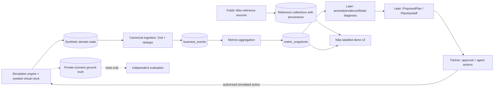

# Normal — Nike Digital Twin: Annotated Contract & Integration Guide

**Project:** Normal — Making seamless operations the new normal  
**Scope:** Nike-branded, unaffiliated hackathon **simulation** using cited public reference data and synthetic internal operations.  
**Authoritative runtime schemas:** [`../packages/contracts/src/contracts.ts`](../packages/contracts/src/contracts.ts)  
**Cross-record checks:** [`../packages/contracts/src/invariants.ts`](../packages/contracts/src/invariants.ts)  
**Original architecture:** [`architecture.mmd`](architecture.mmd)  
**REST boundaries:** [`api.md`](api.md)

> **Read first:** This document explains the canonical v1 contracts; it does not redefine them. If any example or prose conflicts with `src/contracts.ts`, the executable Zod schema wins. Do not silently introduce renamed event types, mutated schema fields, or second copies of the contract.

## 1. Data-origin and truth boundaries

| Data set | Examples | Source of truth | Used by | Safety / quality rule |
|---|---|---|---|---|
| Public Nike reference material | Nike.com product title, public listed price, Nike IR quarterly numbers, official product page | Specific publicly accessed source, dated | Catalogue context; case-study labels | Store full source URL, access timestamp, and `official_public`/`third_party_public`; never call it internal Nike operational data |
| Synthetic Nike operations | Individual orders, shoppers, sales conversion, ad budgets, fulfilment exceptions | Simulator state and domain records | Canonical event ingestion, dashboards, diagnosis | Label as simulated; source = `simulator`; never label as actual Nike transactions |
| Canonical observed data | `BusinessEvent` | Ingestion service and persisted event records | Analytics, anomaly detection, evidence | Immutable and deduplicated; only defined enum values; do not inject hidden fault labels |
| Derived metrics and conclusions | `MetricSnapshot`, eventual `Evidence`, `Diagnosis` | Analytics or validated model output with source references | Normal intelligence | Recompute from stored records; diagnosis is an inference, not hidden truth |
| Hidden simulator ground truth | `ScenarioGroundTruth` | Private simulator/evaluation collections | Scenario assertion tests and independent evaluation ONLY | Never pass this to Mubit or any generated diagnosis/evidence context |
| Executable business changes | `ProposedPlan`, `PlanApproval`, `AgentMission`, `ActionExecution`, `ActionOutcome` | Planner, owner approval, partner agent execution | Approved demo simulator side effects | No execution before version-specific approval, permissions, idempotency and read-back verification |

**Suggested business ID:** `nike_demo` (stable across all records); display name may be `Nike — Unaffiliated Simulation`. This ID is a *demo identity*, not a claim that Nike has connected an account. Source origin is recorded in **reference documents** (e.g. `dataOrigin`, `sourceUrl`, `retrievedAt`) and in **canonical event provenance** (`source`, `provenance.simulated`, `provenance.sourceUrl` when applicable). Do not add `dataOrigin` directly to `BusinessEvent`: it is `.strict()` and will reject unknown fields.

## 2. Exact v1 conventions — must not drift

- `schemaVersion` is **literal integer `1`** on persisted canonical records.
- Date/time uses ISO 8601 strings with explicit offset, ideally UTC `Z`; use the **virtual clock** for simulator `occurredAt` and the real ingestion timestamp for `receivedAt`.
- Prices, spend, revenue, refund and budget use **integer minor units**; for GBP, `2999` means £29.99. Currency is `GBP`, `USD` or `EUR` in the v1 enum.
- Rates (`conversionRate`, `ctr`, `lateDeliveryRate`) are decimal fractions from 0 to 1. `changePercent` is a percentage, e.g. `-25.4` means a 25.4% decline. If denominator is zero, the rate is `null` where schema allows.
- `businessId` scopes business data; the real authenticated principal must determine access. Never rely on arbitrary `businessId` supplied by a browser to authorise access.
- Event idempotency uses unique `(businessId, provenance.connectorId, provenance.sourceRecordId)`; optionally enforce unique `(businessId, eventId)` as well.
- A simulator rerun must preserve deterministic random number generator state *and* simulator virtual time. Repeated requests with the same idempotency key may not create duplicate orders, inventory changes or events.
- The contracts are written for **Zod 3.25.x**. Keep the existing source and install compatible Zod; do not silently migrate to Zod 4 or weaken `.strict()`.
- Canonical `BusinessEvent` is an `event.type` discriminated union: payload fields must exactly match the branch. Extended details belong in associated domain collections, not extraneous payload keys.

## 3. Canonical data model, annotated by use

### `Business`
Business identity/configuration: `schemaVersion`, `businessId`, `name`, `currency`, `timezone`, optional `industry`, `createdAt`. For the hackathon, `businessId = "nike_demo"`, `name = "Nike (unaffiliated digital twin demo)"`; it remains a simulated tenant. Does **not** confer any connection to Nike's real systems.

### `Integration`
Source connector configuration: `integrationId`, `businessId`, `provider` (one of the canonical `Source` enum), `status`, `scopes`, optional `secretReference`, `lastSyncedAt`, `cursor`, `lastError`. Keep secrets outside MongoDB documents; store reference handles, not passwords.

### `BusinessEvent` — immutable event ledger
Required shared fields: `schemaVersion`, `businessId`, `eventId`, `source`, `occurredAt`, `receivedAt`, `provenance`. Optional shared fields: `correlationId`, `simulationRunId`. `provenance` **must include** `sourceRecordId`, `connectorId`, `simulated` and `ingestMethod` (`webhook`, `poll`, `import`, `simulation`, `action_callback`); `sourceUrl` optional.

For synthetic events, use `source: "simulator"`, `provenance.simulated: true`, `provenance.ingestMethod: "simulation"`, and a stable `simulationRunId`. For agent-induced callbacks, use `ingestMethod: "action_callback"` when appropriate.

**Exact v1 variants; no other `type` strings are accepted:**

| Event type | Schema-required payload fields | Simulation producer; meanings |
|---|---|---|
| `web.session_started` | `sessionId`, `device` (`desktop`/`ios`/`android`/`other`), `channel`, optional `campaignId` | Traffic generation; every attributed purchase should refer to a genuine simulated session where possible |
| `order.completed` | `orderId`, `productIds` (nonempty), `grossTotalMinor`, `discountMinor`, `netRevenueMinor`, `currency`; optional `sessionId`, `customerId`, `campaignId` | Simulated completed checkout. Store SKU, quantity, line items, shipping and inventory reservation separately in domain records. Required accounting: net = gross − discount, no negative values |
| `order.refunded` | `orderId`, `refundId`, `refundMinor`, `currency`, optional `reason` | Refund actually associated with existing order; avoid refund total exceeding original collected amount |
| `checkout.failed` | `checkoutId`, `sessionId`, `failureCode`, `device`, optional `couponCode` | Failed checkout; cannot also count as completed order unless later successful attempt is distinct |
| `ad.metrics_observed` | `campaignId`, `window:{startAt,endAt}`, `impressions`, `clicks`, `spendMinor`, `attributedOrders`, `attributedRevenueMinor`, `frequency`, `currency` | Per-window observed ad performance. Clicks ≤ impressions. Derive spend from simulation and budget, then attribution from genuinely linked orders. No fabricated ROAS fields |
| `delivery.status_changed` | `orderId`, `status` (`pending`/`shipped`/`delivered`/`delayed`/`lost`); optional `promisedAt`, `deliveredAt`, `delayMinutes` | Fulfilment changes associated with existing orders. `shipping_delays` is **not** the contract's scenario name |
| `review.created` | `reviewId`, `productId`, `rating` (integer 1–5), `text`, optional `orderId` | Synthetic customer review; retain evidence for rating and delivery influences where relevant |
| `social.mention_observed` | `mentionId`, `platform`, `content`, optional `views`, `productId`, `campaignId` | Real source mentions only if correctly sourced; **synthetic** social buzz otherwise, prominently tagged in provenance |
| `inventory.level_changed` | `productId`, `availableUnits`, `reservedUnits` | Atomic stock changes; no negative stock and no phantom orders |
| `campaign.budget_updated` | `campaignId`, `previousDailyBudgetMinor`, `newDailyBudgetMinor`, `currency`, `actionId` | Agent callback AFTER actual simulated budget modification, not on plan proposal |
| `customer.message_sent` | `messageId`, `orderId`, `customerId`, `templateId`, `deliveryStatus` (`queued`/`sent`/`failed`), `actionId` | Demo-only customer communication to fake inbox/test recipients; never actual Nike customers |
| `storefront.banner_published` | `bannerId`, `message`, `startsAt`, optional `expiresAt`, `actionId` | Verified change to simulated storefront banner |
| `promotion.created` | `promoCode`, nonempty `productIds`, `percentOff` (0–100), `maxRedemptions`, `expiresAt`, `actionId` | Verified promotion, only after approved action |

**Do not create** `session.started`, `campaign.performance`, `shipment.delayed`, `checkout.started`, `product.viewed`, `cart.created` as new `BusinessEvent.type` variants without an explicit agreed versioned contract change. These richer domain interactions may be stored in `simulated_sessions`, `simulated_carts`, `simulated_order_items`, etc.; they are not v1 canonical events. `BusinessEvent` must still be valid as Zod `BusinessEvent`.

### `IngestBatch` / `IngestResult`
- `IngestBatch`: `schemaVersion:1`, `events` array with **1–1000** canonical events.
- `IngestResult`: `accepted`, `duplicates`, `rejected`, `eventIds`.
- Create bulk ingestion that preserves ordered accounting, deduplicates by provenance key, and reports invalid payload errors safely. Test race conditions for two simultaneous inserts using the unique index.

### `MetricSnapshot`
- `snapshotId`, `businessId`, `schemaVersion`, `window`, `currency`, `computedAt`, `completeness`.
- `dimension` may contain `campaignId`, `productId`, `channel`, `device` (all optional). Aggregate by specific dimension or global total—not silently double-counting campaigns and global totals.
- `counters`: `sessions`, `orders`, `revenueMinor`, `refundMinor`, `adSpendMinor`, `impressions`, `clicks`, `attributedOrders`, `shipments`, `delayedShipments`, `reviews`, `lowRatingReviews`.
- `rates`: `conversionRate`, `ctr`, `lateDeliveryRate`, `lowRatingRate`, `costPerAcquisitionMinor`, nullable when not meaningful.
- Snapshot windows must use *simulated occurred time* consistently. Avoid duplicate sums from events representing cumulative metrics: `ad.metrics_observed` represents a measured **window**; produce nonoverlapping windows or use replacement/upsert by campaign/window key.

### Future intelligence records (not implemented in the simulator milestone)
- `Anomaly`: baseline-versus-current metric, cause for triggering investigation, `changePercent`, status; does **not** encode an assumed hidden scenario label.
- `Investigation`: `investigationId`, anomaly references, lifecycle state, linked evidence/diagnosis/plan IDs.
- `Evidence`: observation, actual measurements, typed source-record references. Should be built from accessible business records, not an invented story.
- `DiagnosisModelOutput`: the *only* object requested from the LLM; includes `primaryCause`, evidence-linked hypotheses, summary, missing evidence, and `requiresReview`.
- `Diagnosis`: validated model output enriched **server-side** with `businessId`, `diagnosisId`, `investigationId`, `modelCallId`, `taskKey:"revenue_diagnosis_v1"`, `createdAt`. Do not ask model to author server IDs.
- `ModelCall`, `ModelCorrection`, `AdapterRecord`, `EvaluationCase`, `EvaluationResult`: call tracking, human feedback, task-adapter tracking and held-out tests. MongoDB corrections alone do **not** train a Mubit adapter.

### Handoff records for partner execution (must not be changed by simulator developer)
- `ActionProposal`: versioned discriminated action union; each has `actionId`, `agent`, `title`, `rationale`, evidence IDs, dependency IDs, `requiresApproval:true`, `risk`, typed `actionType`, typed `params`.
- `ProposedPlan`: exact `planId` / `planVersion` / action graph and success criteria. Planner owns this document.
- `PlanHandoff`: `{plan: ProposedPlan, diagnosis: Diagnosis, evidence: Evidence[]}`. Partner reads from `GET /api/plans/:id`.
- `PlanApproval`: owner reviews exact plan **version** and selected action IDs.
- `AgentMission`, `ActionExecution`, `ActionOutcome`: agent workflow, actual tool results and verified business consequences. The simulator provides operation APIs, not premature agent execution.

**Three essential agent action types and simulator adapter requirements:**

| `actionType` | Exact `params` | What the simulator should support |
|---|---|---|
| `ads.set_daily_budget` | `campaignId`, `newDailyBudgetMinor`, `currency` | Read and change existing simulated campaign's daily spend limit. After authorised execution, emit `campaign.budget_updated` and subsequent ticks obey new budget. |
| `customer.send_delay_notice` | nonempty `orderIds`, `templateId`, positive `maxRecipients` ≤1000 | Associate messages with real simulated orders/customers, write to fake/test inbox only; emit `customer.message_sent` after delivery attempt. |
| `storefront.publish_banner` | `bannerId`, `message`, `startsAt`, `expiresAt`, optional `promoCode` | Persist banner visible on storefront, emit `storefront.banner_published` once verified. |

Stretch actions `marketing.publish_ad`, `customer.send_promotion_email`, `storefront.create_discount` already exist in v1; not required to finish simulator foundation. Agent implementation belongs to the other developer. **Do not publish unauthorised mutable APIs** just because service functions exist.

### `SimulatorRun`, simulation API shapes and private truth
`SimulatorRun` fields: `schemaVersion`, `businessId`, `simulationRunId`, `seed` (integer), `status`, `virtualTime`, `minutesPerTick`, `activeScenario`, `scenarioSeverity`, `createdAt`, `updatedAt`.

Valid `activeScenario`: `healthy`, `ad_fatigue`, `delivery_delays`, `negative_reviews`, `promo_checkout_failure`, `viral_demand`.

- `InjectScenarioRequest`: `{simulationRunId, scenario, severity}` where severity is 0–1.
- `SimulatorTickRequest`: `{simulationRunId, ticks}` where ticks is positive integer max 60, defaults to 1.
- `SimulatorTickResponse`: `{simulationRunId, virtualTime, generatedEventIds, generatedEventsCount, metricSnapshotIds}`.
- `ScenarioGroundTruth`: `{simulationRunId, scenario, actualCauses, hiddenFaultParameters}`. PRIVATE and only for independent scenario verification/evaluation; never in model evidence or user-facing metrics APIs.

If a seeded bootstrap API is needed, define it as a **supplementary** request, validate it, and document it. Do not break the four existing schemas above. Add optional UI summary wrappers instead of changing the canonical response.

## 4. Concrete example of a canonical Nike-simulation event

```json
{
  "schemaVersion": 1,
  "businessId": "nike_demo",
  "eventId": "ev_run42_order_0001",
  "source": "simulator",
  "occurredAt": "2026-10-24T10:15:00Z",
  "receivedAt": "2026-10-24T10:15:01Z",
  "provenance": {
    "sourceRecordId": "run42_order_0001",
    "connectorId": "nike_simulator_v1",
    "simulated": true,
    "ingestMethod": "simulation"
  },
  "simulationRunId": "run42",
  "type": "order.completed",
  "payload": {
    "orderId": "order_0001",
    "sessionId": "session_0042",
    "customerId": "cust_0200",
    "productIds": ["nike_product_01"],
    "grossTotalMinor": 12999,
    "discountMinor": 0,
    "netRevenueMinor": 12999,
    "currency": "GBP",
    "campaignId": "campaign_running_a"
  }
}
```

Illustrative ID and price only—not a claim about a current Nike product or sale. Actual SKU, line items and inventory stock checks belong in persisted domain records.

## 5. Functional causal simulation model

- **Catalogue:** source a small set of Nike products from public pages when accessible; store product URLs, observed GBP prices, and retrieval dates. Cache enough source material to work without live internet. If source cannot be verified, mark demo fallback as synthetic, not real.
- **Visitors:** generate sessions (optionally campaign-linked). Product views, cart and checkout are *domain interactions*. A completed checkout emits `order.completed`. Failed checkout emits `checkout.failed`.
- **Inventory:** check and reserve stock atomically; completed order decrements available units and emits `inventory.level_changed`. Never produce negative available units, inconsistent totals or two successful checkouts of the last unit.
- **Advertising:** campaign budget influences impression opportunity, spend, clicks and attributable sessions, with creative fatigue reducing CTR over time. Attribution references actual simulated sessions/orders. Aggregate emits `ad.metrics_observed` for disjoint windows.
- **Fulfilment:** schedule delivery statuses for existing orders, respecting virtual time; delay settings affect subsequent shipping outcomes; customer reviews may be delayed accordingly.
- **Fault injection:** inject *mechanistic parameters*, not output numbers. `ad_fatigue` changes ad engagement; `delivery_delays` changes fulfilment hazard, `viral_demand` changes external traffic; `negative_reviews` and `promo_checkout_failure` can follow as second-wave extensions.
- **Demonstration:** Nike business shown as **“Nike — simulated operations, unaffiliated demo”** in the UI. Do not imitate brand ownership or present synthetic incidents as real Nike news.

## 6. Suggested domain collections (supplementary, NOT replacements for shared contracts)

`reference_products`, `reference_financials`, `reference_public_signals` — public observations with provenance and retrieval time.  
`simulator_state`, `simulator_ground_truth` — durable clock, seed, random state, active fault, private labels.  
`simulated_products`, `simulated_inventory`, `simulated_sessions`, `simulated_carts`, `simulated_orders`, `simulated_campaigns`, `simulated_shipments`, `simulated_reviews`, `simulated_storefront` — current mutable business state and rich details.  
`business_events` — immutable canonical event ledger.  
`metric_snapshots` — computed outcomes for known time windows.  

A document may include `_id` plus rich supplementary domain fields; **never** add these extra fields to `.strict()` canonical Zod payloads.

## 7. Critical indexes and concurrency rules

- `business_events`: unique `{businessId:1, "provenance.connectorId":1, "provenance.sourceRecordId":1}`.
- Optional unique `{businessId:1, eventId:1}` for explicit event-ID integrity.
- `simulator_state`: unique `{businessId:1, simulationRunId:1}`; implement atomic version/lease or transaction-level protection for concurrent ticks.
- `simulated_orders`: unique `{businessId:1, orderId:1}`; likewise sessions and customer references where applicable.
- `ad.metrics_observed`: deterministic event provenance key for each `(run, campaign, time window)` to prevent double aggregation.
- `metric_snapshots`: unique `(businessId, snapshotId)` or deterministic `(businessId, window, dimension)` upserts.
- For real checkout, use an atomic inventory check-and-decrement. Never assume a naive read-then-write is safe under concurrent checkouts.
- If using transactions, test them against the actual Atlas environment; if unavailable, implement idempotent atomic operations and explicitly document their guarantees.

## 8. REST contract ownership and test plan

**Implement now:** development-authenticated simulator start/seed, `/api/dev/simulator/inject`, `/api/dev/simulator/tick`, `/api/dev/simulator/state`, `/api/ingest/events` (appropriately protected), `/api/metrics` and demo checkout/storefront reads. Maintain canonical request schemas even if using a `/api/dev/` prefix for controlled simulator operations.

**Do not implement now:** `/api/investigations/:id/diagnose`, `/api/investigations/:id/propose-plan`, `/api/plans/:id/approve|execute`, production connectors, real customer email, real Nike actions. Instead provide mockable service functions and preserve `PlanHandoff` compatibility.

### Non-negotiable tests
1. Install matching Zod3 deps; run bundled typecheck and fixture validation, then Next.js typecheck/lint/build.
2. Every fixture event passes canonical `BusinessEvent.parse()`. Unrecognised keys and event types fail.
3. Ingestion accepts new events once and returns duplicate count on replay; concurrent duplicate race is safe.
4. Same seed + initial state + request sequence creates same **business observations** (ignore wall-clock ingestion fields and DB IDs). Persist PRNG state across server restart.
5. Financial invariants: all order line totals sum to expected gross/net revenue; refunds never exceed sales; ad spend obeys budget.
6. Campaign clicks ≤ impressions; attribution derives from linked orders; metrics recomputed from event ledger match dashboard values.
7. Simulated scenarios change relevant *inputs and underlying behaviour*, not revenue or chart numbers directly. Compare multiple seeded replicates to avoid one-off random outcomes.
8. Delivery statuses refer to actual orders; time never travels backwards; reviews reflect plausible customer experiences.
9. Shopper checkout genuinely creates an order, updates inventory and recomputes revenue; refresh shows persisted data.
10. Marketing budget mutation via bounded, **authorised** service changes later campaign behaviour; emits correct callback only after execution; customer notices stay in a test inbox, banners affect the demo storefront.
11. Simulated fault labels are absent from all `BusinessEvent`, `MetricSnapshot`, evidence-eligible API views and Mubit inputs.
12. Source provenance tests reject treating synthetic facts as official Nike data; UI visibly labels demo and public references.
13. All mutation routes are inaccessible outside development or a separately authenticated demo configuration.
14. Concurrent tick, duplicate request, stock exhaustion, invalid input and backend outage paths are tested.
15. Report exactly which checks actually ran, including failures/blockers; no fabricated results.

## 9. Integration schematic



**No edge connects hidden ground truth to the AI path.** This is a deliberate isolation boundary.

## 10. Team contract and acceptance gate

- **Intelligence developer** owns Nike references, simulator, ingestion, metrics, anomaly/evidence/diagnosis/planning (later).
- **Execution developer** owns approval UI, React Flow agent visualisation, orchestration, safe action adapters, verification and outcome logs.
- Both must use the **same** `ProposedPlan`, `PlanHandoff`, `PlanApproval`, `ActionExecution` schemas.
- The simulator team should supply safe, well-documented read/write adapters; the execution team supplies approval/policy checks. Never give generated model text raw DB write powers.

**Simulator “done” means:** a user can simulate a Nike product purchase; MongoDB records a Zod-valid, deduplicated `order.completed`; inventory and revenue change correctly; incidents influence subsequent events; the numbers survive refresh/restart; authorised changes to campaign state affect later ticks; and tests prove these behaviours. It does **not** mean the entire Normal intelligence system is finished.
