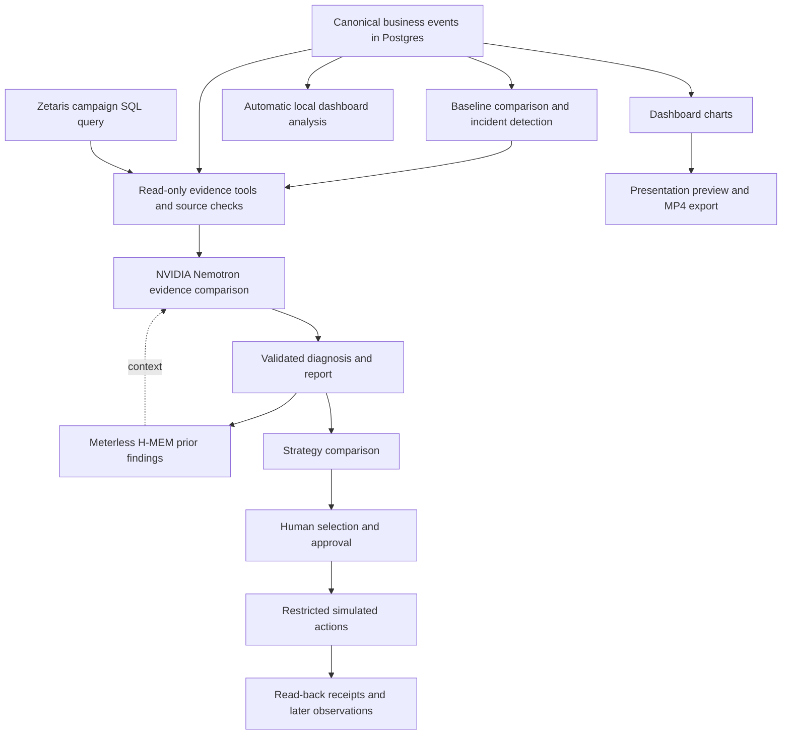

# How ExplainWhy works

ExplainWhy follows one investigation from an observed change to evidence, a qualified diagnosis, a reviewed response, and a record of what happened. The current app uses Next.js, TypeScript, Postgres, and NVIDIA Nemotron, with Zetaris and Meterless H-MEM in the evidence and memory paths.

## Investigation

The monitor works from observable events and metric snapshots. It compares a completed period with its baseline, groups related findings, and opens an investigation. Private simulator controls and planted causes are excluded from this causal investigation path.

Evidence tools retrieve advertising, checkout, revenue, inventory, shipping, and historical context. Zetaris supplies advertising observations joined to the campaign catalogue. The other operational tools read the app's canonical records. Deterministic checks verify scope, dates, source references, and measurements before the model can cite them.

Local Nemotron selects competing explanations and supporting or conflicting evidence through compact structured decisions. The app renders the narrative fields and exact numbers. A report can remain unresolved; a valid JSON response alone does not make a diagnosis eligible for planning.

[Controller](../src/intelligence/investigator/controller.ts) · [Local decisions](../src/intelligence/investigator/local-decisions.ts) · [Evidence tools](../src/intelligence/evidence/tools/)

## Memory

Published reports become durable history. Meterless H-MEM retrieves relevant earlier findings within the permitted business, run, and time boundaries. The recalled material retains its original investigation references and a create/read ledger. New evidence must still support the current explanation.

[H-MEM adapter](../src/integrations/meterless/history.ts) · [Report persistence](../src/integrations/meterless/persistence.ts)

## Planning, review, and execution

Planning requires a completed, validated diagnosis and a ready handoff. In local mode, the server constructs supported options, validates their targets and evidence, and asks Nemotron to rank them. Unsupported interventions are excluded, so observation and further investigation can be the only available choices.

A person selects a strategy. Executable changes require approval of the exact plan version and action set, followed by a separate execution step. Restricted adapters update the simulated business, read the result back, and save receipts. Later outcome assessments compare available observations; they do not establish that the action caused a change.

[Planning flow](nvidia-planning.md) · [Validation](../src/planner/validation.ts) · [Execution](../src/execution/) · [Outcomes](../src/outcomes/)

## Automatic summaries and presentation exports

Automatic dashboard analysis has its own worker and saved reports. It watches scoped database revisions and builds a packet from canonical metrics, the run clock, and selected operational fields. A dashboard summary cannot replace the investigation's diagnosis or unlock planning.

Chart exports capture the displayed values and period. The preview and video use the same renderer, and an open export retains its snapshot even as the live dashboard refreshes.

[Automatic analysis](automatic-local-analysis.md) · [Presentation exports](dashboard-presentations.md)

## Run the services

With Postgres and Ollama available, `npm run dev:analysis` starts the web app, dashboard analysis worker, investigator, and planner at port 8772. The [quick-start launcher](QUICKSTART.md) also starts the monitor and uses port 3000 by default. The basic setup leaves optional sponsor services off until configured.

[Back to the project](../README.md)
